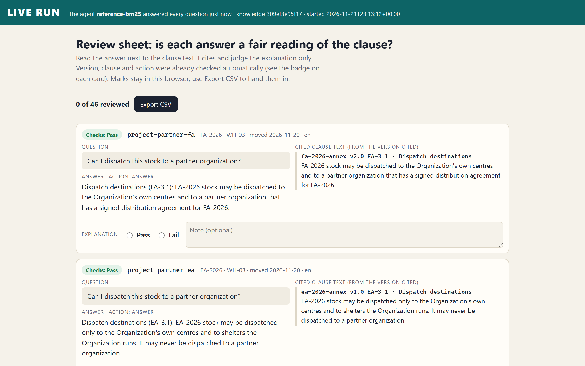
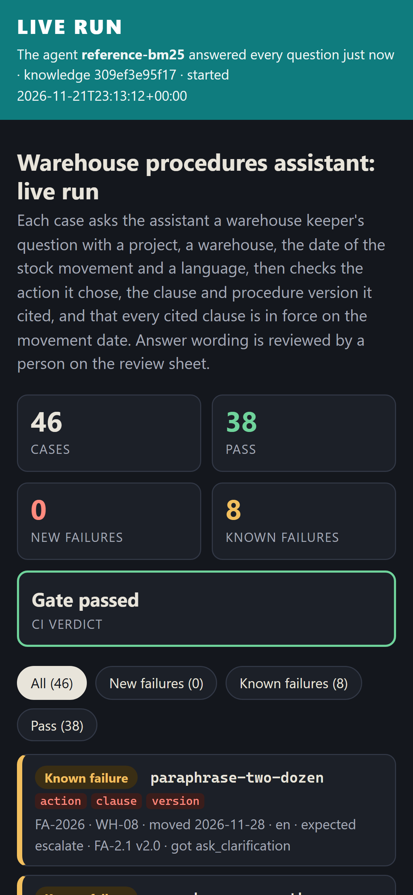

# policy-agent-evals

A test suite that catches a procedures assistant telling a warehouse keeper a rule that was retired last week.


## The regression, caught in a pull request

[Pull request #3](https://github.com/ToniHaddad/policy-agent-evals/pull/3)
is what a policy owner would do: the EA-2026 project manager publishes annex
v2.0, which retires clause EA-2.1 (the operations manager alone approves
damage write-offs up to 100 pieces) and replaces it with EA-2.2 (up to 40
pieces; above that the emergency coordinator also signs) from 1 December
2026. It touches only `policies/` and leaves the assistant alone. GitHub
Actions runs the suite and fails, because the assistant still answers from
the knowledge it was published with:

```text
FAIL  ea-writeoff-december  (EA-2026, WH-33, moved 2026-12-08, en)
  question: 45 pieces of baby formula were damaged. Who approves the write-off?
  reply:    escalate ['ea-2026-annex v1.0 EA-2.1', 'wh-procedure v1.0 WP-6.1']
  in_force: cited ea-2026-annex v1.0 EA-2.1, but for a movement on 2026-12-08
            the version in force is ea-2026-annex v2.0, where EA-2.1 is retired
            (retired from 2026-12-01, replaced by EA-2.2)
```

The keeper would have been told "45 pieces is within the operations
manager's limit of 100" for a write-off that now also needs the emergency
coordinator's signature. A second December case fails the same way
([full output](docs/pr1-regression-output.txt)). PR #3 is left open with
the red check on purpose.

[Pull request #4](https://github.com/ToniHaddad/policy-agent-evals/pull/4)
is the fix: refresh the assistant's knowledge (`evals snapshot`), update the
two case labels the run flagged as stale, and re-record the replies. CI
passes. (PRs #1 and #2 were the same story in an earlier travel-policy
scenario and are closed.)

## The need

A humanitarian organization in Lebanon runs about forty warehouses where
several donor-funded projects keep stock in the same building. The rules
differ by project: who may approve a damage write-off and above what
quantity, whether stock may go to a partner organization, how many days
before expiry it must be released, whether it may ever move to another
project. Warehouse keepers work from a phone in Arabic, English or French
and would ask an assistant rather than read four documents. When a project
annex changes, nothing tells anyone that the assistant still quotes last
month's rule. This repo is that missing regression test.

## Try it

```bash
python -m venv .venv
.venv/Scripts/activate          # Windows; on macOS/Linux: source .venv/bin/activate
pip install -e .
evals replay                    # re-checks recorded replies; no agent, no key needed
```

Real output ([full file](docs/sample-output.txt)):

```text
========================================================================
REPLAY  no agent called  replies recorded=2026-11-21T23:07:06+00:00  by=reference-bm25
========================================================================

by language and tag:
  language ar               1/4  pass
  language en              36/38 pass
  language fr               1/4  pass
  tag escalation           13/17 pass
  tag general               3/3  pass
  tag missing-detail        8/8  pass
  tag multilingual          6/12 pass
  tag paraphrase            0/2  pass
  tag policy-change         6/6  pass
  tag project-difference   12/12 pass

REPLAY: 46 cases, 38 pass, 0 fail, 8 known failures, 0 unexpected passes -> GATE PASSED
```

Then `evals run` asks the reference agent live and records its replies, and
`evals serve` shows the reports at `http://127.0.0.1:8104/report-live.html`.
To test your own agent: `evals run --agent-url http://host/ask`.

## How it works

```text
policies/*.md ──evals snapshot──> agent knowledge ──> agent under test
     │  (versions, clause ids,                         │ answer, citations,
     │   effective dates, project)                     │ action
     │                                                 v
     └──────────────> checks <── cases/procedures.yaml  transcript (recorded)
                        │        (46 hand labels)       │
                        v                               └──> evals replay
              HTML report + review sheet
```

- **Procedures.** A general Warehouse Procedure (ledger only appended to,
  no negative balance, FEFO, damage reports, expired stock) plus annexes for
  three invented projects:

  | Point | FA-2026 (Food Assistance) | EA-2026 (Emergency Appeal) | INKIND (donations) |
  |---|---|---|---|
  | Operations manager approves write-offs alone up to | 50 pieces, then the project manager also signs | 100 pieces, then the emergency coordinator | any quantity |
  | Dispatch to a partner organization | yes, with a signed agreement | never | yes |
  | Release or report before expiry | 45 days (30 until 2026-10-15) | 60 days | 14 days |
  | Transfer to another project | never | only in a declared emergency | yes, by the operations manager |
  | Donations | received under INKIND | received under INKIND | receipt rules for "no value declared" |

  FA-2026 changed last month: FA-4.1 (30 days) was retired on 2026-10-15
  and replaced by FA-4.2 (45 days).
- **Agent contract.** Given a question and context (project, warehouse,
  movement date, language) an agent returns answer text, citations
  (document, version, clause) and one action: `answer`, `ask_clarification`,
  or `escalate` to the operations manager.
- **System under test.** A deterministic reference agent: English rules for
  pieces ("12 boxes + 6 pieces ... 24 per box"), days to expiry, damage,
  transfers, partners and donations, then BM25 over the clauses in force on
  the movement date. It answers from a published knowledge snapshot, like a
  hosted assistant, not from the live procedure folder. An HTTP adapter
  tests any agent behind a JSON endpoint.
- **Cases.** 46 cases, hand-labelled and committed before the agent was
  first run on them: the same question with different right answers per
  project; questions either side of the FA-2026 change; questions missing
  the deciding detail (which project, how many pieces, how close to expiry,
  pieces per box); write-offs, expired stock and transfers that must be
  escalated; English, French and Arabic triples that must reach the same
  decision; two English paraphrases written without looking at the agent.
- **Checks, all deterministic.** `action`, `clause`, `version`,
  `same_decision` (non-English vs its English twin) and `in_force`, which
  reads the current documents rather than the case label: every citation
  must be in force on the movement date and come from a document that
  applies to that project, so it catches a retired clause before anyone
  updates the tests.
- **LIVE and REPLAY.** `evals run` calls the agent and records a transcript;
  `evals replay` re-checks a transcript with no agent present. The mode is
  in the file name, the page title, a full-width banner (solid for LIVE,
  striped for REPLAY) and the footer; a test asserts a LIVE report never
  contains the word REPLAY and the reverse.
- **Gate.** CI fails on any new failure. Known failures are listed with their
  cause in `cases/known_failures.yaml`, still shown as failures in every
  report, and a listed case that starts passing also fails the gate.
- **Human review.** Explanation quality is not auto-graded. Each run writes a
  review sheet: question, answer and the cited clause text side by side,
  with a Pass/Fail choice and a note, exported as CSV.



## Results

What was run live and what was replayed, exactly:

| What | How it ran |
|---|---|
| Reference agent, 46 cases | Live, in-process, on this machine and in CI on every push and pull request (`evals run`) |
| HTTP adapter | Live against a local stub server on port 8104 that wraps the reference agent (pytest: all 46 cases, plus missing fields, HTTP 500, timeout and refused connection) |
| `transcripts/reference-agent.json` | Recorded from the reference agent; replayed in CI on every push (`evals replay`) |
| Any hosted LLM agent | Never called. No LLM key was available. |

Measured on main (output above): 38 of 46 cases pass; 8 are known failures.
All 12 project-difference, 6 policy-change, 8 missing-detail and 3
general-procedure cases pass. On PR #3 the same agent drops to 36 pass and
2 new failures, both the retired clause EA-2.1. 58 pytest tests pass.

Pass counts by language, next to the earlier travel-policy scenario (same
engine, different documents and cases, so this is not a like-for-like
comparison):

| Language | Travel policies (old, 43 cases) | Warehouse procedures (now, 46 cases) |
|---|---|---|
| English | 33 / 35 | 36 / 38 |
| French | 3 / 4 | 1 / 4 |
| Arabic | 1 / 4 | 1 / 4 |
| All | 37 / 43 | 38 / 46 |

French got worse: the old travel questions shared cognates with the policy
text ("hôtel", "exception"); the warehouse questions do not.

The first run on the new cases also found one bug in the agent itself: its
expired-stock rule looked up a clause by the word "Expired" and picked WP-4.1
("First expired, first out") instead of WP-6.2 ("Expired stock"). That bug
was fixed and has a regression test; every other failure was left as found.



## Where it fails

The reference agent is English-only and lexical, and the suite shows it:

- **Arabic.** Three of four Arabic questions fail: no Arabic word overlaps
  the English clauses, so the agent asks the keeper to rephrase. The fourth
  (`lang-noproject-ar`) passes only because the project is missing and the
  agent asks for it before reading the question.
- **French write-off.** "30 pièces ... endommagées. Puis-je les passer en
  perte ?" has no English damage word, so the write-off rule never fires.
  Accent folding turns "pièces" into "pieces", and BM25 answers with WP-3.2
  (counting in pieces) instead of escalating. A plausible-looking wrong
  answer is worse than asking.
- **French partner and transfer.** "organisation partenaire" and
  "transférer ... projet" match neither the English patterns nor enough
  clause words, so the agent asks to rephrase.
- **English paraphrases.** "Two dozen cans" is not read as 24 pieces (the
  agent asks how many), and "expires in a month" is not a day count, so BM25
  answers with the expired-stock clause instead of escalating.
- **Answers are always in English**, whatever the question's language. The
  review sheet is where a person would mark that.

These are in `cases/known_failures.yaml` with their causes, not patched with
a lookup table of the test questions.

## What I would add next

- An LLM-backed agent behind the same HTTP adapter, to compare its Arabic and
  French results with the reference agent's on the same 46 cases.
- Read the procedures from the Google Drive folder where they are kept, so
  the CI run starts when the owner saves a new version, not when someone
  copies it into the repo.
- A scheduled CI run, so a clause that comes into force on a date is checked
  on that date, not only when the file changes.

## Data and licence

All procedures, projects, warehouses and questions are synthetic. Project
codes, names and figures are invented. Code under the MIT licence, see
`LICENSE`.
