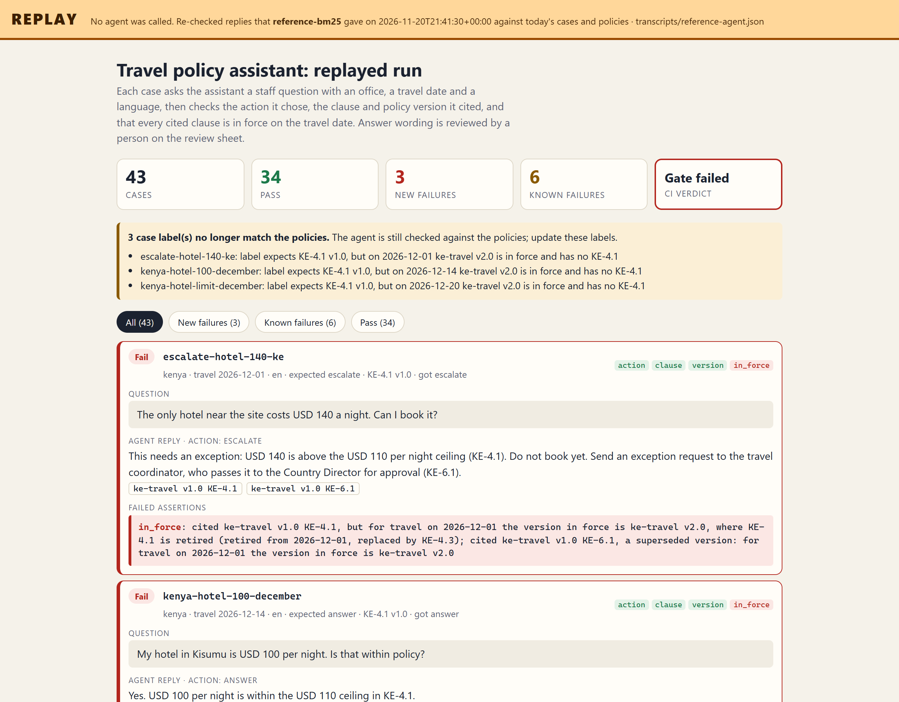

# policy-agent-evals

A test suite that catches a workplace policy assistant citing a retired rule before staff do.



## The regression, caught in a pull request

[Pull request #1](https://github.com/ToniHaddad/policy-agent-evals/pull/1) is
what a policy owner would do: Kenya publishes travel policy v2.0, which
retires clause KE-4.1 (hotels up to USD 110 a night) and replaces it with
KE-4.3 (USD 90) from 1 December 2026. It touches only `policies/` and leaves
the assistant alone. GitHub Actions runs the suite and fails. The assistant
is still answering from the knowledge it was published with:

```text
FAIL  kenya-hotel-100-december  (kenya, travel 2026-12-14, en)
  question: My hotel in Kisumu is USD 100 per night. Is that within policy?
  reply:    answer ['ke-travel v1.0 KE-4.1']
  in_force: cited ke-travel v1.0 KE-4.1, but for travel on 2026-12-14 the version
            in force is ke-travel v2.0, where KE-4.1 is retired (retired from
            2026-12-01, replaced by KE-4.3)
```

A staff member would have been told "yes, USD 100 is fine" for a trip that
now needs an exception. The same failure hits two more December cases
([full output](docs/pr1-regression-output.txt)). PR #1 is left open with
the red check on purpose.

[Pull request #2](https://github.com/ToniHaddad/policy-agent-evals/pull/2)
is the fix: refresh the assistant's knowledge (`evals snapshot`), update the
three case labels the run flagged as stale, and re-record the replies. CI
passes.

## The need

Organisations now put assistants (Microsoft Copilot Studio agents and
similar) in front of their policy documents, and staff trust the answers.
A policy changes, the document is updated, and nothing tells anyone that
the assistant still quotes last month's rule. Most "evals" grade whether an
answer sounds right; few check that the clause it cites was in force on the
date that matters. This repo is that missing regression test, written so a
policy owner's change triggers it.

## Try it

```bash
python -m venv .venv
.venv/Scripts/activate          # Windows; on macOS/Linux: source .venv/bin/activate
pip install -e .
evals replay                    # re-checks recorded replies; no agent, no key needed
```

Real output ([full file](docs/sample-output.txt)):

```text
========================================================================
REPLAY  no agent called  replies recorded=2026-11-20T21:41:30+00:00  by=reference-bm25
========================================================================

by language and tag:
  language ar               1/4  pass
  language en              33/35 pass
  language fr               3/4  pass
  tag escalation            8/12 pass
  tag missing-detail        8/8  pass
  tag multilingual          8/12 pass
  tag office-difference    13/13 pass
  tag paraphrase            0/2  pass
  tag policy-change         6/6  pass

REPLAY: 43 cases, 37 pass, 0 fail, 6 known failures, 0 unexpected passes -> GATE PASSED
report:       reports/report-replay.html
review sheet: reports/review-sheet-replay.html
```

Then `evals run` asks the reference agent live and records its replies, and
`evals serve` shows the reports at `http://127.0.0.1:8104/report-live.html`.
To test your own agent: `evals run --agent-url http://host/ask`.

## How it works

```text
policies/*.md ──evals snapshot──> agent knowledge ──> agent under test
     │  (versions, clause ids,                         │ answer, citations,
     │   effective dates)                              │ action
     │                                                 v
     └──────────────> checks <── cases/travel.yaml   transcript (recorded)
                        │        (43 hand labels)      │
                        v                              └──> evals replay
              HTML report + review sheet
```

- **Policies.** Two fictional Northbridge Relief offices, as versioned
  Markdown. They differ on notice (Lebanon 10 days, Kenya 5), hotel ceiling
  (USD 120 vs 110) and who approves an exception (Head of Office vs Country
  Director). Lebanon changed last month: LB-3.1 (7 days) was retired on
  2026-10-15 and replaced by LB-3.2 (10 days).
- **Agent contract.** Given a question and context (office, travel date,
  language) an agent returns answer text, citations (document, version,
  clause) and one action: `answer`, `ask_clarification`, or `escalate` to
  the travel coordinator.
- **System under test.** A deterministic reference agent: BM25 over the
  clauses of the version in force on the travel date, plus English rules
  for day counts, nightly rates and missing details. It answers from a
  published knowledge snapshot, like a hosted assistant, not from the live
  policy folder. An HTTP adapter tests any agent behind a JSON endpoint.
- **Cases.** 43 hand-labelled cases: the same question with different right
  answers per office; questions either side of the Lebanon change; questions
  missing the deciding detail (only asking is right); exceptions that must be
  escalated; English, French and Arabic triples that must reach the same
  decision; two English paraphrases written without looking at the agent.
- **Checks, all deterministic.** `action`, `clause`, `version`,
  `same_decision` (non-English vs its English twin) and `in_force`, which
  reads the current policies rather than the case label, so it catches a
  retired clause before anyone updates the tests.
- **LIVE and REPLAY.** `evals run` calls the agent and records a transcript;
  `evals replay` re-checks a transcript with no agent present. The mode is
  in the file name, the page title, a full-width banner (solid for LIVE,
  striped for REPLAY) and the footer, and a test asserts that a LIVE report
  never contains the word REPLAY and the reverse.
- **Gate.** CI fails on any new failure. Known failures are listed with their
  reason in `cases/known_failures.yaml`, still shown as failures in every
  report, and a listed case that starts passing also fails the gate.
- **Human review.** Explanation quality is not auto-graded. Each run writes a
  review sheet: question, answer and the cited clause text side by side,
  with a Pass/Fail choice and a note, exported as CSV.


## Results

What was run live and what was replayed, exactly:

| What | How it ran |
|---|---|
| Reference agent, 43 cases | Live, in-process, on this machine and in CI on every push and pull request (`evals run`) |
| HTTP adapter | Live against a local stub server on port 8104 that wraps the reference agent (pytest, 43 cases plus error cases: missing fields, HTTP 500, timeout, refused connection) |
| `transcripts/reference-agent.json` | Recorded from the reference agent; replayed in CI on every push (`evals replay`) |
| Copilot Studio or any hosted LLM agent | Never called. No Microsoft tenant and no LLM key were available. |

Measured on main (output above): 37 of 43 cases pass; 6 are known failures.
All 13 office-difference cases, all 6 policy-change cases and all 8
missing-detail cases pass. English: 33 of 35. French: 3 of 4. Arabic: 1 of 4.
On PR #1 the same agent drops to 34 pass and 3 new failures, all three the
retired clause KE-4.1. 54 pytest tests pass.


## Where it fails

The reference agent is English-only and lexical, and the suite shows it:

- **Arabic.** `lang-ceiling-ar` and `lang-approver-ar`: no Arabic word
  overlaps the English clauses, BM25 scores 0, and the agent asks the user
  to rephrase. The English and French versions of both questions pass.
- **French and Arabic deadlines.** `lang-late-fr` ("Mon voyage part dans 4
  jours") and `lang-late-ar`: the day-count rule only knows "days", so the
  deadline is missed. BM25 then matches the bare digit 4 to "sections 3 or 4"
  in LB-6.1 and the agent answers with the exceptions clause instead of
  escalating. A lexical retriever matching on a section number is a real
  failure mode, not a test artefact.
- **One Arabic pass is luck.** `lang-nodate-ar` passes only because the
  agent asks for a missing travel date before it reads the question.
- **English paraphrases.** "My trip leaves in a week" is not read as 7 days
  (the agent asks instead of escalating), and "130 a night" without a
  currency is not read as a rate, so BM25 picks the advance-booking clause
  because of the word "book".
- **Answers are always in English**, whatever the question's language. The
  review sheet is where a person would mark that.

These are listed in `cases/known_failures.yaml` with these reasons, not
patched with a lookup table of the test questions.

## What I would add next

- Connect a Copilot Studio agent through the HTTP adapter (a small relay that
  turns its reply into the citation contract) and record a real transcript.
- An LLM-backed agent behind the same adapter, to compare its multilingual
  results with the reference agent's on the same 43 cases.
- A scheduled CI run, so a policy that comes into force on a date is checked
  on that date, not only when the file changes.

## Data and licence

All policies, offices and questions are synthetic. Northbridge Relief is a
fictional organisation. Code under the MIT licence, see `LICENSE`.
